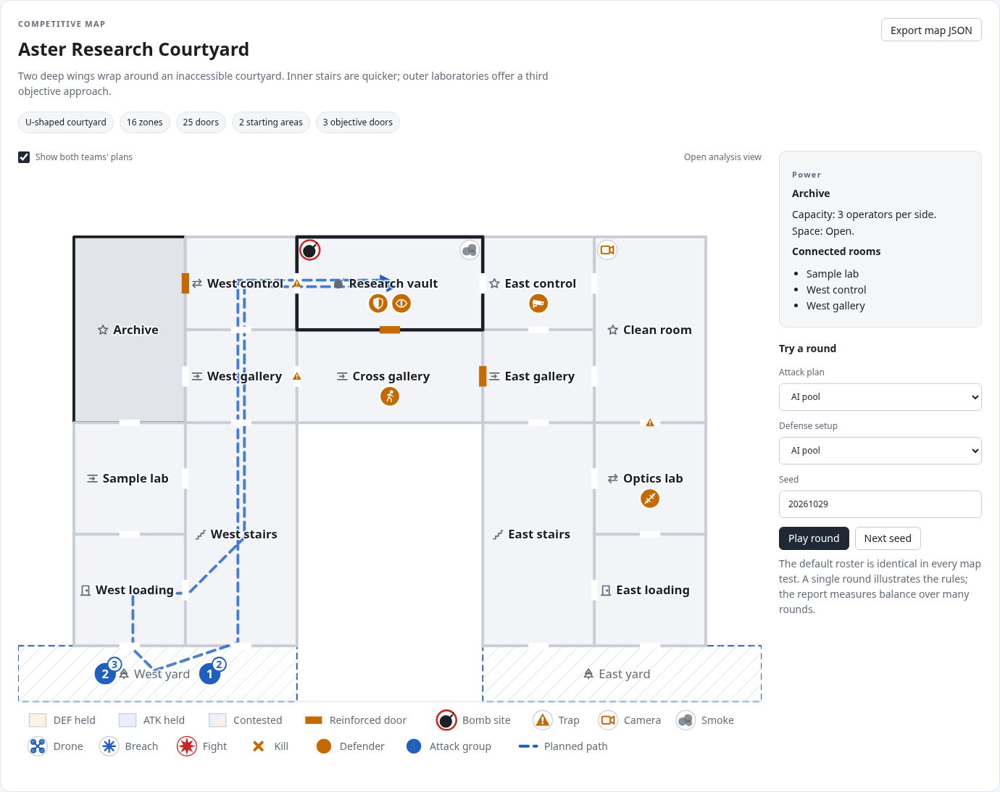
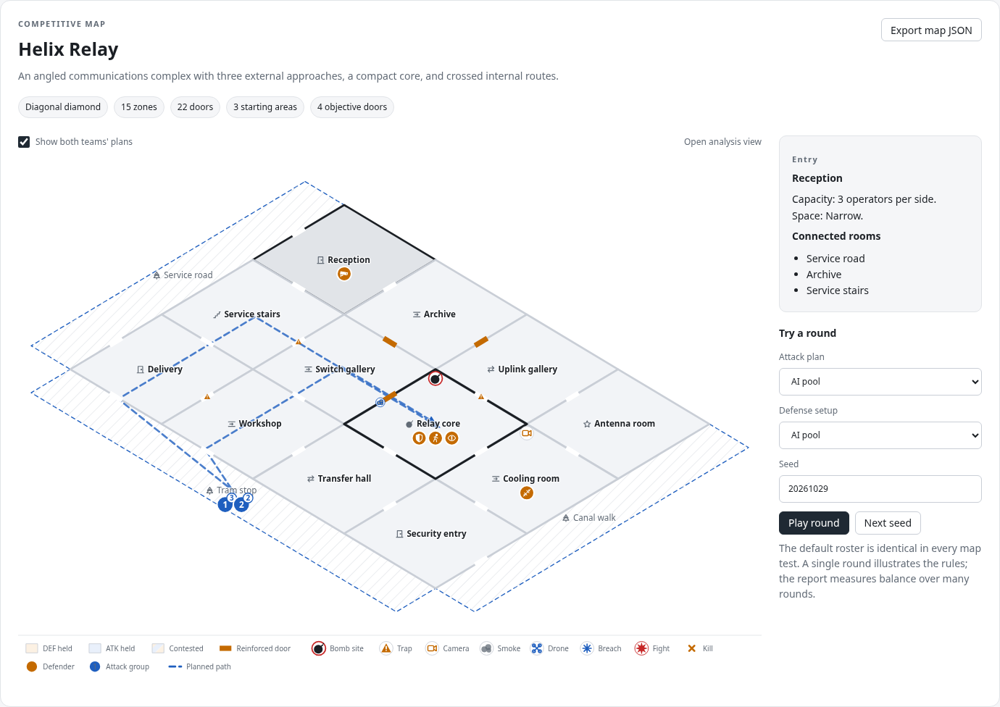
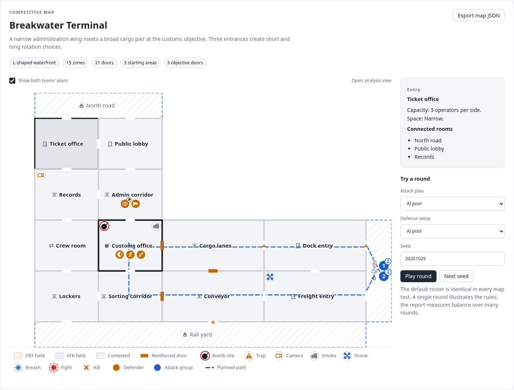
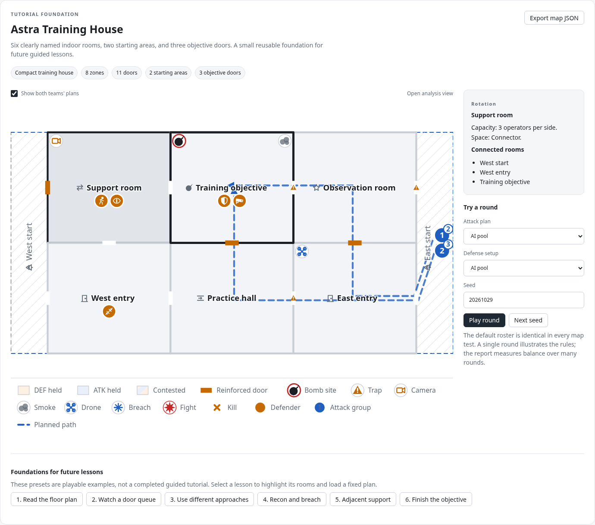

# Astra map pack

Three new competitive layouts and one compact tutorial foundation for Squad Sim. Everything added for this pack lives in `astraWork/`; the workshop uses the existing V4 engine, renderer, roster, and replay.

## Open the workshop

From the repository root:

```bash
python3 -m http.server 8000 --bind 127.0.0.1
```

Open **http://127.0.0.1:8000/astraWork/**.

Choose a map, inspect rooms and doors, toggle both teams' plans, select an AI/template matchup, and play a seeded round. The replay supports pause, speed, scrubbing, and a complete event table. **Export map JSON** downloads the selected map.

The workshop has no build step, backend, or application dependencies. It does not load or modify the original demo's ladder save. Mobile keeps the map in a horizontal scroll area instead of shrinking its labels indefinitely.

The page uses classic scripts and local assets, so direct local-file opening may work in an ordinary browser. This managed environment blocks `file://` navigation by administrator policy; the verified launch path is the HTTP server above.

## Maps

| Map | Form | Zones / doors | Starts | Objective doors | Tactical identity |
|---|---|---:|---:|---:|---|
| **Aster Research Courtyard** | U-shaped building around an inaccessible courtyard | 16 / 25 | 2 | 3 | Two connected wings; faster inner stairs and longer outer approaches. |
| **Helix Relay** | Diagonal diamond | 15 / 22 | 3 | 4 | Crossed internal routes; several ways to change the direction of an entry. |
| **Breakwater Terminal** | L-shaped waterfront | 15 / 21 | 3 | 3 | A narrow administration wing and cargo lanes meet at the building's elbow. |
| **Astra Training House** | Compact rectangular training house | 8 / 11 | 2 | 3 | Six indoor rooms with clear names, short routes, and space to demonstrate the basic rules. |

All three competitive maps have at least three edge-disjoint approaches from the starting areas to the objective. Each room has a valid interior anchor; every door sits on a shared wall. Shapes affect the physical floor plan and connectivity, not just background art.

<details>
<summary>Aster Research Courtyard preview</summary>



</details>

<details>
<summary>Helix Relay preview</summary>



</details>

<details>
<summary>Breakwater Terminal preview</summary>



</details>

<details>
<summary>Astra Training House preview</summary>



</details>

## Balance evidence

Read [BALANCE.md](BALANCE.md) for the measured results and [balance-results.json](balance-results.json) for counts, individual seed batches, policies, counterplans, and source hashes.

The competitive release gate requires:

- The entire 95% Wilson interval for ATK wins to fit inside **45–55%**, independently for the original AI pools and newly generated plans.
- At most **15% timeout endings** in either primary mode.
- A coordinated legal attack with at least **40% measured wins against each predefined defense**, evaluated on seeds separate from plan selection.

Each map receives **4,000 independent rounds per primary mode**. Additional tests cover every A/B/C versus S/P/R template pair, each starting area, equal-base-stat rosters, complete matches with abilities, and coordinated counterplay. Every simulated round also receives rule-invariant checks.

Development exposed an initially ATK-favored terminal, followed by a DEF bias under fresh plan generation. Its objective connections and approach-room types were adjusted, then checked on a new held-out seed set. The global combat rules and tuning constants were not changed.

These results describe **the current V4 rules and the tested roster/policy distributions**. Specific tactics can perform much better or worse than the map average. The report preserves those results instead of hiding them. Human optimal play is not proven by a finite AI sample, and the maps need another balance pass after V5's plant, recon, and order changes.

The tutorial map is measured and reported, but is deliberately **not certified by the competitive gate**. Its layout and fixed lesson fixtures are intended for teaching.

## Tutorial foundation

Choose **Astra Training House** to reveal six playable example presets:

| Preset | What it demonstrates | Verified behavior or future teaching goal |
|---|---|---|
| Read the floor plan | Starting areas, rooms, doors, and the objective | Room selection and adjacency inspection. |
| Watch a door queue | Two groups using the same approach | At least one operator actually queues at a door. |
| Use different approaches | A group through each side of the house | Compare arrival timing and local encounters. |
| Recon and breach | An occupied support room and a reinforced objective door | The drone reports a defender; the planned charge opens that door. |
| Adjacent support | Fighting with teammates in neighboring rooms | The replay contains actual support participation. |
| Finish the objective | Site control and the final round event | Observe V4 behavior now; replace the objective lesson after V5 is implemented. |

`tutorial.js` exports the lesson metadata and fixed scenario builder. Presets use stable room IDs and the normal engine validators. They are a foundation for future onboarding, not a completed progression system or pass/fail teaching campaign.

For the next tutorial iteration:

1. Keep each lesson's permitted actions small.
2. Use objective/event predicates for success rather than requiring a lucky kill.
3. Add staged instruction and retry around the existing fixture.
4. After V5, update the recon commitment and plant/defuse lessons before presenting them as the current rules.

## Run the checks

Node is sufficient for geometry, scenario, and balance checks:

```bash
node astraWork/maps.test.js
node astraWork/balance.js
```

The first command validates all four maps, AI pools, template fixtures, deterministic replay, room/door limits, and six tutorial presets: **842 audited rounds**, plus replay-repeat checks.

The second command writes the reproducible balance report and exits nonzero if a competitive release gate fails. It takes substantially longer. Its defaults are the settings recorded in the checked-in report:

```bash
node astraWork/balance.js --rounds=2000 --seeds=193751,9518427 --template-rounds=200 --spawn-rounds=400 --matches=200
```

Use `--out=/tmp/astra-balance-check` to write a trial report outside the repository. Small trial samples may fail the confidence-interval gate even when their point estimate is close to 50%.

The optional browser check requires Python, Playwright, and either system Chromium or Playwright's installed Chromium:

```bash
python3 astraWork/browser-smoke.py
```

It starts its own temporary loopback server and checks all four map replays, all six lesson presets, keyboard room selection, a real JSON download, preservation of the original ladder key, and a 390-pixel viewport. It attempts `file://` separately and explicitly reports a skip if administrator policy blocks it.

The unchanged original suite was also run successfully before and after this work:

```bash
node demo/engine.test.js --routes --sens
```

Its existing non-failing soft warnings remain: Meridian Office Tower's flank advantage of **15.7 percentage points** and the equipment/trait power budget of **6.7 percentage points**. Those refer to the original maps/rules, not failures of this map pack.

## Files and integration

| File | Purpose |
|---|---|
| `maps.js` | Four map definitions, metadata, and shared-wall door placement; browser `ASTRA_MAPS` and CommonJS export. |
| `index.html`, `workshop.js`, `workshop.css` | Map inspection, plan previews, round playback, tutorial selectors, and JSON export. |
| `assets.js` | Resolves the original portrait and weapon assets before roster creation, so replay works from the workshop directory. |
| `tutorial.js` | Six lesson descriptions and legal fixed scenarios. |
| `validate.js`, `maps.test.js` | Geometry, connectivity, path, replay, round-invariant, and tutorial checks. |
| `balance-core.js`, `counterplay.js`, `balance.js` | Reproducible sampling, coordinated-plan selection, held-out evaluation, and report generation. |
| `BALANCE.md`, `balance-results.json` | Human-readable and machine-readable results for the recorded source hashes. |
| `browser-smoke.py` | Repeatable browser checks with a temporary local server. |
| `previews/` | Screenshots of the maps rendered by the actual workshop. |

The original demo remains the original three-map game. The workshop registers the pack only in its own page. To reuse the pack in another browser entry point, load `astraWork/maps.js` after `demo/maps.js`, then register the desired entries before loading the engine:

```js
Object.assign(MAPS2, ASTRA_MAPS);
```

For a normal competitive rotation, register only entries where `map.meta.kind === 'competitive'`. Keep the tutorial behind its own lesson entry. In Node:

```js
const maps = require('./demo/maps.js');
const pack = require('./astraWork/maps.js');
Object.assign(maps, pack);
const Engine = require('./demo/engine.js');
```

The original `engine.test.js` intentionally expects exactly three original maps and contains original-map fixtures. Use this pack's dedicated tests when registering the additional layouts. If the main application adopts them later, update its map-count assumptions, random rotation, ladder compatibility, and V5 balance report as part of that integration.
